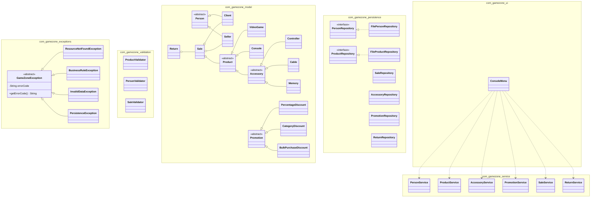

# GameZone Architecture: Old vs. New Class Diagram Comparison

This document provides a side-by-side comparison between the initial (old) class diagram and the updated (new) class diagram for the **GameZoneUnicesar** system.

---

## 1. Architectural Comparison Summary

| Module / Layer                  | Initial (Old) Architecture                                                       | Updated (New) Architecture                                                            | Key Improvements                                                                                          |
| :------------------------------ | :------------------------------------------------------------------------------- | :------------------------------------------------------------------------------------ | :-------------------------------------------------------------------------------------------------------- |
| **Presentation (`ui`)**         | `ConsoleMenu`                                                                    | `GameZoneUI`, `ReturnReceiptPrinter`, `WarrantyCertificatePrinter`                    | Renamed UI main controller to match source code; added dedicated receipt and certificate printer classes. |
| **Model (`model`)**             | Missing `Warranty` hierarchy                                                     | Added `Warranty` (abstract), `BasicWarranty`, `ExtendedWarranty`                      | Complete domain coverage for product warranties and extension rules.                                      |
| **Validation (`validation`)**   | `ProductValidator`, `PersonValidator`, `SaleValidator`                           | Added `PromotionValidator`, `ReturnValidator`                                         | Comprehensive input and rule validation across all business transactions.                                 |
| **Service (`service`)**         | Basic services (`Product`, `Person`, `Sale`, `Accessory`, `Promotion`, `Return`) | Added `WarrantyService`, `ItemStockService`, mappers, and lookup helpers              | Decoupled stock management and warranty processing into specialized service objects.                      |
| **Persistence (`persistence`)** | Partial repositories                                                             | Added `ISaleRepository`, `FileSaleRepository`, `WarrantyRepository`, Codecs & Mappers | Strict adherence to Dependency Inversion (DIP) with explicit interfaces and serialization codecs.         |

---

## 2. Key Changes by Package

### 🛡️ Domain Models (`com.gamezone.model`)

- **Warranty Module Integrated:** Added `Warranty` abstract base class with concrete `BasicWarranty` and `ExtendedWarranty` subclasses.
- **Return Refinements:** Extended `Return` entity with warranty refund tracking (`warrantyRefundAmount`).

### 🛠️ Validation Layer (`com.gamezone.validation`)

- **Added `PromotionValidator`:** Validates discount boundaries, active dates, and target categories.
- **Added `ReturnValidator`:** Validates 30-day return policy constraints and product eligibility prior to processing refunds.

### 💾 Persistence Layer (`com.gamezone.persistence`)

- **Interface Abstraction:** Introduced `ISaleRepository` interface implemented by `FileSaleRepository`.
- **Warranty Persistence:** Added `WarrantyRepository` and `FileWarrantyRepository`.
- **Codecs & Mappers:** Integrated subtype codecs (`AccessoryCodec`, `PromotionCodec`, `SubtypeCodec`) and mappers (`ReturnRecordMapper`, `WarrantyRecordMapper`).

### 🖨️ Presentation Layer (`com.gamezone.ui`)

- **Controller Alignment:** Updated main UI class from `ConsoleMenu` to `GameZoneUI`.
- **Dedicated Printers:** Included `ReturnReceiptPrinter` and `WarrantyCertificatePrinter` for formatted document generation.

---

## 3. Old Mermaid Class Diagram

---

## 4. New (Updated) Mermaid Class Diagram

```mermaid
classDiagram
direction TB

    namespace com_gamezone_exceptions {
        class GameZoneException {
            <<abstract>>
            -String errorCode
            +getErrorCode() String
        }
        class ResourceNotFoundException {
            +ResourceNotFoundException(String resourceType, String id)
        }
        class BusinessRuleException {
            +BusinessRuleException(String message)
        }
        class InvalidDataException {
            +InvalidDataException(String fieldName, String reason)
        }
        class PersistenceException {
            +PersistenceException(String message, Throwable cause)
        }
    }

    namespace com_gamezone_validation {
        class ProductValidator {
            +validateProductData(String id, String title, double price, int stock)$+validateStockAvailability(Product product, int requestedQuantity)$
            +validateProductExists(Product product, String productId)$+validateUniqueProduct(Product existingProduct, String newId)$
        }
        class PersonValidator {
            +validatePersonData(String id, String name, String email, String phone)$
            +validatePersonExists(Person person, String personId)$+validateUniquePerson(List~Person~ existing, String newId)$
        }
        class SaleValidator {
            +validateSaleData(Client client, Seller seller, List~Product~ products)$+validateSaleExists(Sale sale, String saleId)$
        }
        class PromotionValidator {
            +validatePromotionData(String id, String name)$+validatePromotionExists(Promotion promotion, String id)$
        }
        class ReturnValidator {
            +validateReturnData(String returnId, String reason)$+validateCanBeReturned(Sale sale)$
        }
    }

    namespace com_gamezone_model {
        class Person {
            <<abstract>>
            -String identification
            -String name
            -String phone
            +getIdentification() String
            +getName() String
        }
        class Client {
            -String email
            -List~Sale~ purchaseHistory
        }
        class Seller {
            -String employeeId
            -String shift
        }
        class Product {
            <<abstract>>
            -String id
            -String title
            -double price
            -int stock
            +getDescription() String
            +getId() String
            +getPrice() double
            +getStock() int
            +setStock(int stock)
        }
        class VideoGame {
            -String platform
            -String genre
            -String ageRating
            +getDescription() String
        }
        class Console {
            -String brand
            -String model
            -String generation
            +getDescription() String
        }
        class Accessory {
            <<abstract>>
            -List~String~ compatibleConsoleIds
            +getCompatibleConsoleIds() List~String~
            +getDescription() String
        }
        class Controller {
            -String connectionType
            +getDescription() String
        }
        class Cable {
            -double length
            -String connectorType
            +getDescription() String
        }
        class Memory {
            -int capacity
            -String storageType
            +getDescription() String
        }
        class Warranty {
            <<abstract>>
            -String warrantyId
            -LocalDate startDate
            -LocalDate endDate
            +getDurationInMonths() int
            +getWarrantyType() String
            +getAdditionalCost(Product product) double
            +isActive() boolean
        }
        class BasicWarranty {
            +getDurationInMonths() int
            +getWarrantyType() String
            +getAdditionalCost(Product product) double
        }
        class ExtendedWarranty {
            -int extraMonths
            -double percentageCost
            +getDurationInMonths() int
            +getWarrantyType() String
            +getAdditionalCost(Product product) double
        }
        class Sale {
            -String id
            -String date
            -double total
            -String appliedPromotionName
            -double discountAmount
            +calculateTotal() double
            +canBeReturned() boolean
        }
        class Promotion {
            <<abstract>>
            -String id
            -String name
            -LocalDate startDate
            -LocalDate endDate
            +isActive(LocalDate date) boolean
            +calculateDiscount(Sale sale) double
        }
        class PercentageDiscount {
            -double percentage
            +calculateDiscount(Sale sale) double
        }
        class CategoryDiscount {
            -double percentage
            -String targetCategory
            +calculateDiscount(Sale sale) double
        }
        class BulkPurchaseDiscount {
            -int minQuantity
            -double percentage
            +calculateDiscount(Sale sale) double
        }
        class Return {
            -String returnId
            -LocalDate date
            -String reason
            -double refundAmount
            -double warrantyRefundAmount
            +calculateRefundAmount() double
            +getWarrantyRefundAmount() double
        }
    }

    namespace com_gamezone_persistence {
        class PersonRepository {
            <<interface>>
            +saveAll(List~Person~ persons)
            +loadAll() List~Person~
        }
        class FilePersonRepository {
            +saveAll(List~Person~ persons)
            +loadAll() List~Person~
        }
        class ProductRepository {
            <<interface>>
            +saveAll(List~Product~ products)
            +loadAll() List~Product~
        }
        class FileProductRepository {
            +saveAll(List~Product~ products)
            +loadAll() List~Product~
        }
        class ISaleRepository {
            <<interface>>
            +saveAll(List~Sale~ sales)
            +loadAll() List~Sale~
        }
        class FileSaleRepository {
            +saveAll(List~Sale~ sales)
            +loadAll() List~Sale~
        }
        class AccessoryRepository {
            +saveAll(List~Accessory~ accessories)
            +loadAll() List~Accessory~
        }
        class PromotionRepository {
            +saveAll(List~Promotion~ promotions)
            +loadAll() List~Promotion~
        }
        class ReturnRepository {
            +saveAll(List~Return~ returns)
            +loadAll() List~Return~
        }
        class WarrantyRepository {
            +saveAll(List~Warranty~ warranties)
            +loadAll() List~Warranty~
        }
    }

    namespace com_gamezone_service {
        class PersonService {
            +registerClient(Client client)
            +listClients()
            +listSellers()
        }
        class ProductService {
            +registerVideoGame(VideoGame videoGame)
            +registerConsole(Console console)
            +listProducts()
            +updateStock(String id, int quantity)
            +restoreStock(String productId, int quantity)
        }
        class AccessoryService {
            +registerController(Controller controller)
            +registerCable(Cable cable)
            +registerMemory(Memory memory)
            +listAllAccessories()
            +findCompatibleWith(String consoleId)
            +updateStock(String id, int quantity)
        }
        class PromotionService {
            +registerPercentageDiscount(String id, String name, double percentage)
            +registerCategoryDiscount(String id, String name, double percentage, String category)
            +registerBulkPurchaseDiscount(String id, String name, int minQty, double percentage)
            +listAllPromotions()
            +listActivePromotions()
            +findBestPromotionFor(Sale sale) Promotion
        }
        class SaleService {
            +registerSale(Client client, Seller seller, List~Product~ items)
            +listAllSales()
        }
        class ReturnService {
            +registerReturn(String saleId, List~String~ productIds, String reason) Return
            +viewAllReturns() List~Return~
            +generateMonthlyBalance(int month, int year) double
        }
        class WarrantyService {
            +issueWarranty(Sale sale, Product product, String warrantyType) Warranty
            +cancelWarranty(String warrantyId)
            +getActiveWarranties() List~Warranty~
        }
    }

    namespace com_gamezone_ui {
        class GameZoneUI {
            +start()
            -showMainMenu()
            -showProductMenu()
            -showSaleMenu()
            -showReturnMenu()
            -showWarrantyMenu()
        }
        class ReturnReceiptPrinter {
            +generateReturnReceipt(Return returnObj)$ String
        }
        class WarrantyCertificatePrinter {
            +generateCertificate(Warranty warranty, Product product)$ String
        }
    }

    %% Exceptions
    RuntimeException <|-- GameZoneException
    GameZoneException <|-- ResourceNotFoundException
    GameZoneException <|-- BusinessRuleException
    GameZoneException <|-- InvalidDataException
    GameZoneException <|-- PersistenceException

    %% Models
    Person <|-- Client
    Person <|-- Seller

    Product <|-- VideoGame
    Product <|-- Console
    Product <|-- Accessory

    Accessory <|-- Controller
    Accessory <|-- Cable
    Accessory <|-- Memory

    Warranty <|-- BasicWarranty
    Warranty <|-- ExtendedWarranty

    Promotion <|-- PercentageDiscount
    Promotion <|-- CategoryDiscount
    Promotion <|-- BulkPurchaseDiscount

    %% Persistence Implementations
    PersonRepository <|.. FilePersonRepository
    ProductRepository <|.. FileProductRepository
    ISaleRepository <|.. FileSaleRepository

    %% Model Associations
    Sale o-- Client : "places"
    Sale o-- Seller : "handles"
    Sale o-- Product : "contains"

    Return o-- Sale : "references"
    Return o-- Product : "contains partial"

    Warranty o-- Product : "covers"

    %% UI Coupling
    GameZoneUI ..> PersonService
    GameZoneUI ..> ProductService
    GameZoneUI ..> SaleService
    GameZoneUI ..> AccessoryService
    GameZoneUI ..> PromotionService
    GameZoneUI ..> ReturnService
    GameZoneUI ..> WarrantyService
    GameZoneUI ..> ReturnReceiptPrinter : "uses"
    GameZoneUI ..> WarrantyCertificatePrinter : "uses"
    GameZoneUI ..> GameZoneException : "catches"

    %% Service to Validation
    ProductService ..> ProductValidator : "invokes"
    PersonService ..> PersonValidator : "invokes"
    SaleService ..> SaleValidator : "invokes"
    PromotionService ..> PromotionValidator : "invokes"
    ReturnService ..> ReturnValidator : "invokes"

    %% Validation Exceptions
    ProductValidator ..> InvalidDataException
    ProductValidator ..> BusinessRuleException
    ProductValidator ..> ResourceNotFoundException

    PersonValidator ..> InvalidDataException
    PersonValidator ..> BusinessRuleException
    PersonValidator ..> ResourceNotFoundException

    SaleValidator ..> InvalidDataException
    SaleValidator ..> BusinessRuleException

    ReturnValidator ..> BusinessRuleException

    %% Service to Persistence
    PersonService ..> FilePersonRepository
    ProductService ..> FileProductRepository
    AccessoryService ..> AccessoryRepository
    PromotionService ..> PromotionRepository
    SaleService ..> FileSaleRepository
    ReturnService ..> ReturnRepository
    WarrantyService ..> WarrantyRepository
```

